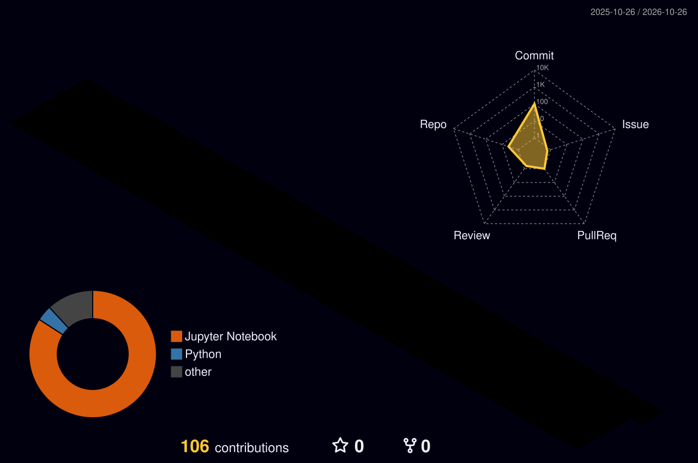

## 

I'm a bootcamp student building full-stack skills — from Java and Spring to React and Python data work.
I keep my coursework in one place and write study notes along the way.

## 

## 

| Repository | What's inside |
| --- | --- |
| [**shieldusboot**](https://github.com/lycoris613/shieldusboot) | All bootcamp material in one repo: Java, Spring Framework, Spring Boot, HTML/CSS/JS/React, web scraping, and study notes |

## 

## 

## 

